# Voxa: итоговый отчёт

**Коротко.** Приложение, статистика, оверлей, ребрендинг и настройки сделаны и проверены на Linux (Rust, TypeScript, Playwright, скриншоты). **Не выполнены два пункта приёмки: зелёный CI с артефактом `Voxa-macos-arm64.zip` и PR в `main`.** Сессия не смогла записать ничего в GitHub (403 на `git push`, на создание ветки через MCP и через API), поэтому ветка не отправлена, workflow не запускался и логов CI нет. Причина и способ снять блокер: [BLOCKERS.md](BLOCKERS.md), B-03. Весь код закоммитирован в ветке `claude/magical-ritchie-lg9k96`, архив ветки (`git bundle`) отправлен вам отдельно.

## Что сделано, по фазам

| Фаза             | Результат                                                                                                                                                                                                                                                                                                                                                                                                                                      |
| ---------------- | ---------------------------------------------------------------------------------------------------------------------------------------------------------------------------------------------------------------------------------------------------------------------------------------------------------------------------------------------------------------------------------------------------------------------------------------------- |
| 0. Разведка      | [ARCHITECTURE_NOTES.md](ARCHITECTURE_NOTES.md): пайплайн, оверлей, история, настройки, апдейтер, точки правок. Добавлен remote `upstream` (cjpais/Handy). Доступ к Actions на чтение есть, на запись нет.                                                                                                                                                                                                                                      |
| CI               | `.github/workflows/voxa-macos.yml`: job `checks` (Linux: переводы, ESLint, Prettier, tsc, unit-тесты, `cargo fmt`, `cargo test`) и job `build-macos` (macos-latest: `tauri build` для aarch64, ad-hoc подпись, zip, артефакт `Voxa-macos-arm64`). **Ни разу не запускался (B-03).** Локальный путь: [BUILD_LOCAL.md](BUILD_LOCAL.md), `scripts/voxa/build-mac.sh`.                                                                             |
| 3. Ребрендинг    | `productName` Voxa, `identifier` `com.daniyar.voxa`, данные в `~/Library/Application Support/com.daniyar.voxa/`. Свои иконка (SVG → `tauri icon`) и иконки трея. Апдейтер выключен насовсем, ссылки на донаты и upstream убраны, телеметрии в коде не было (поиск по sentry, posthog, analytics и т. п.). Атрибуция «Based on Handy by CJ Pais» в README и «О программе», LICENSE не тронут. Импорт слов из Handy: только чтение, по согласию. |
| 5.1 Метрики      | Отдельная база `voxa_stats.db` со своими миграциями (D-05): `duration_ms`, `transcribe_ms`, `model_id`, `language`, `raw_text`, `final_text`, `replacements_json`, счётчики слов (всего, латиница, кириллица). Старая `history.db` не меняется, её записи один раз импортируются. Счётчики не зависят от лимита истории.                                                                                                                       |
| 5.2 Статистика   | Экран «Статистика»: слова сегодня, за неделю (пн–вс), за всё время, диктовки и минуты, среднее, доля латиницы, слова по дням за 30 дней, таблица моделей (avg и p95; при n < 20 «мало данных»), кандидаты в словарь двух видов, кнопка «Добавить в словарь» (пишет в `custom_words` сразу). Очистка статистики.                                                                                                                                |
| 4. Оверлей       | Капсула 220×48 в стиле Liquid Glass: запись (7 столбиков по уровню микрофона и таймер), распознавание (столбики перетекают в мерцающую полоску), готово (галочка, растворение через ~650 мс), ошибка (красноватое стекло, 2 с), ✕ при наведении, Esc отменяет. Нативная вибрация HUD под окном на macOS, «Уменьшить движение» и «Уменьшить прозрачность» учтены. `/voxa-preview` и скриншоты.                                                  |
| 4.3 Главное окно | Перекраска через токены ([glass.css](../src/voxa/glass.css), [theme.css](../src/styles/theme.css)), без переписывания логики экранов. После вашего референса направление изменено на тёмное «редакционное» (D-12).                                                                                                                                                                                                                             |
| 6. Настройки     | Whisper large-v3-turbo Q8_0 первый в рекомендованных (D-02, D-10), язык Russian, словарь из 14 терминов, редактируемая фраза-подсказка для Whisper, выгрузка модели через 10 минут, буфер обмена восстанавливается, хоткей «держать или нажать» как в Handy, история 200 записей.                                                                                                                                                              |

## Скриншоты

Оверлей на синтетических рабочих столах (настоящих скриншотов macOS в песочнице нет), тёмный и светлый фон, пёстрый фон для проверки читаемости:

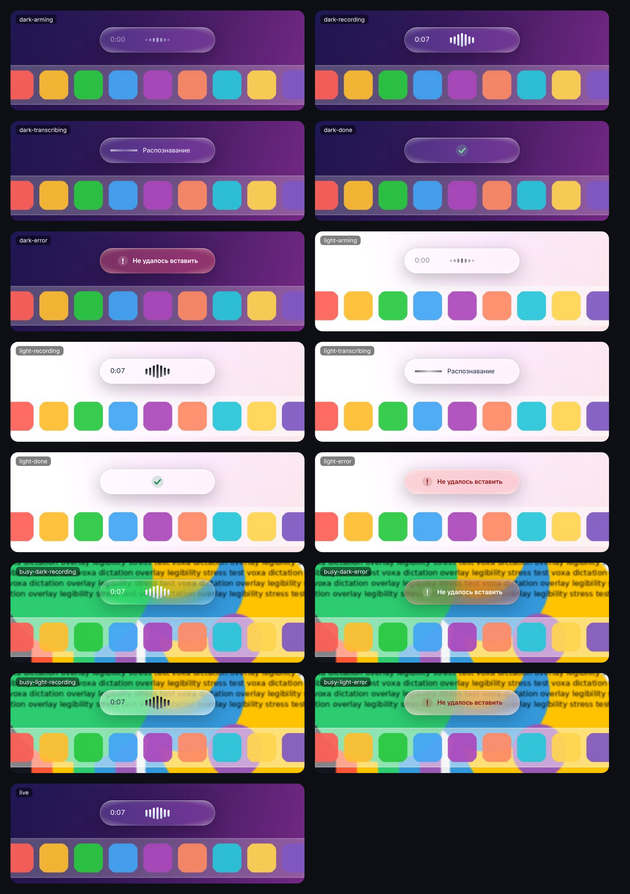

Крупно: запись, наведение (виден ✕), распознавание, ошибка.

| Тёмный                                            | Светлый                                            |
| ------------------------------------------------- | -------------------------------------------------- |
| 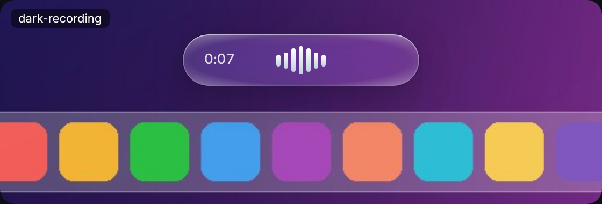       | 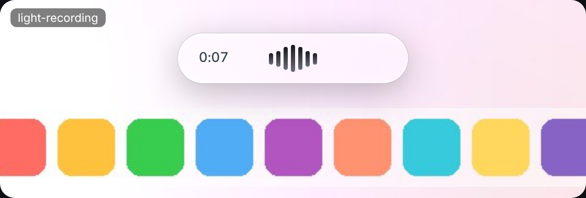       |
| 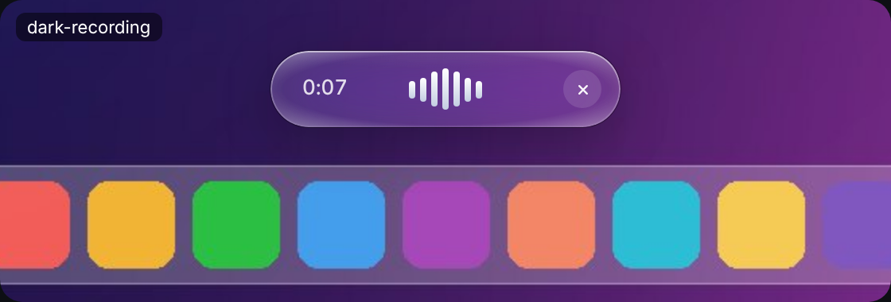 | 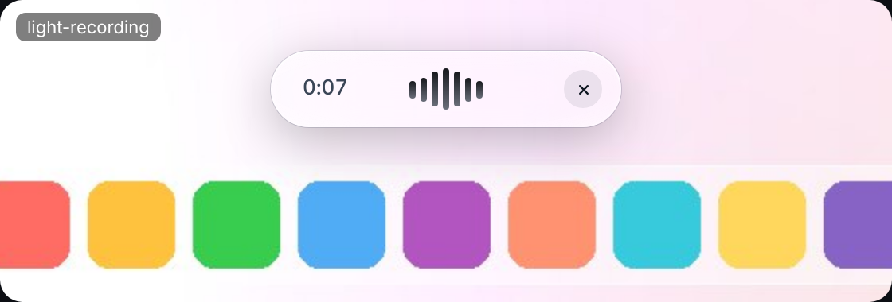 |
|     | 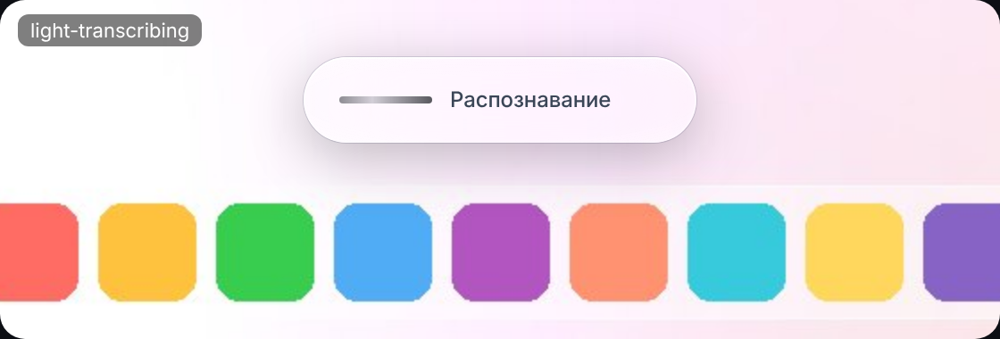    |
| 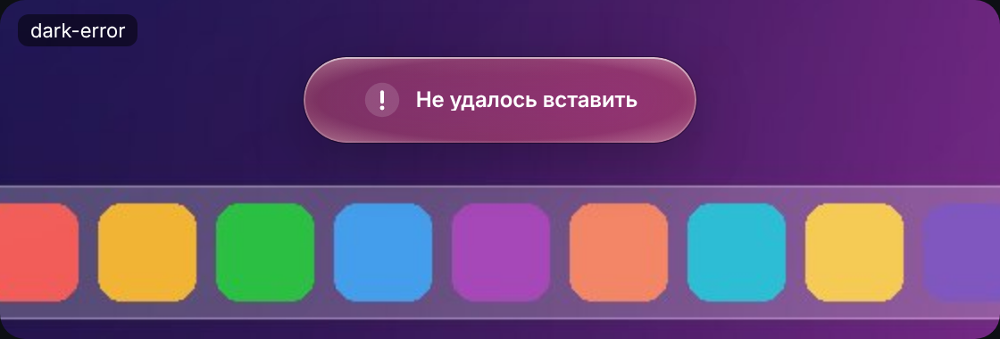           | 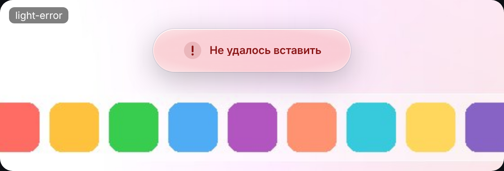           |

Экран статистики (данные для скриншотов фиктивные, из `src/voxa/preview/fixtures.ts`):

| Тёмная тема                          | Светлая тема                          |
| ------------------------------------ | ------------------------------------- |
| 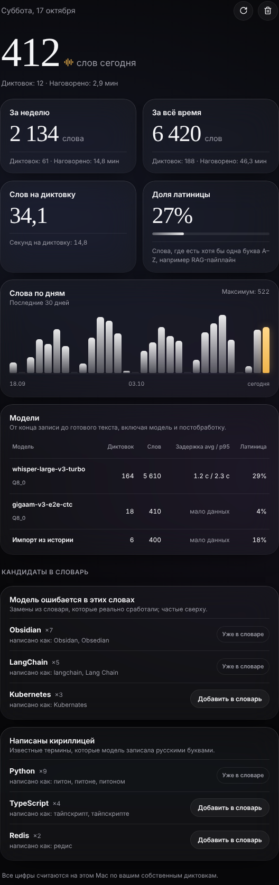 | 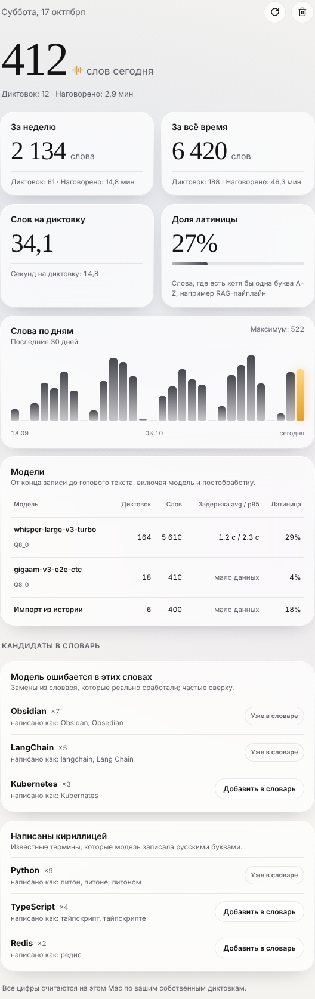 |

Главное окно:

| Тёмная тема                                  | Светлая тема                                  |
| -------------------------------------------- | --------------------------------------------- |
| 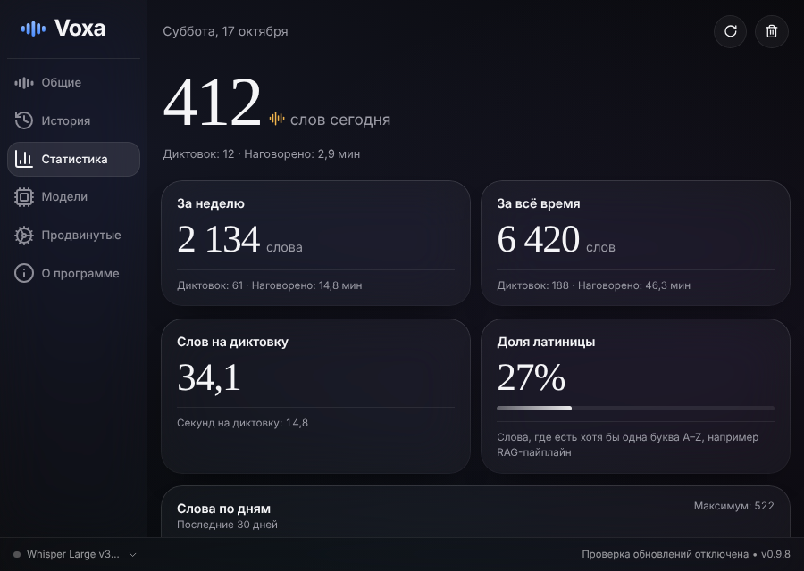 | 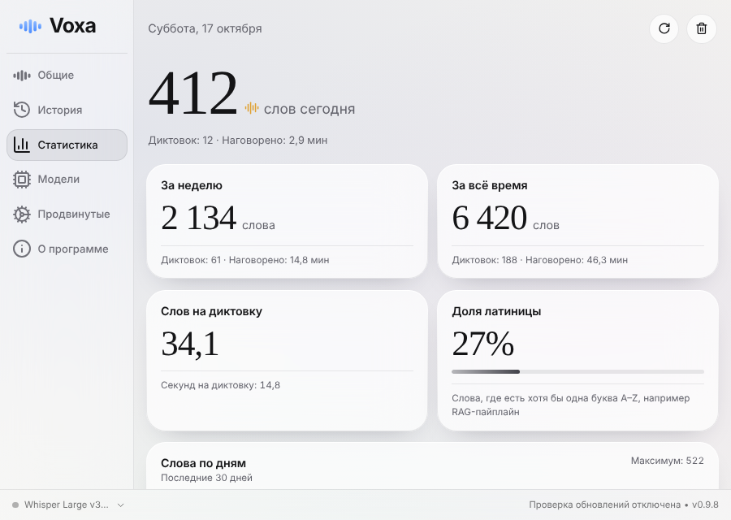 |
|         |         |

Пустое состояние: [statistics-empty-dark.png](screenshots/statistics-empty-dark.png). Режимы доступности: [dark-recording-reduced](screenshots/overlay-dark-recording-reduced.png), [light-transcribing-reduced](screenshots/overlay-light-transcribing-reduced.png).

## Что проверено и чем

| Проверка             | Результат                                                                                                                                                                                                                                                                                                                                                                                           |
| -------------------- | --------------------------------------------------------------------------------------------------------------------------------------------------------------------------------------------------------------------------------------------------------------------------------------------------------------------------------------------------------------------------------------------------- |
| `cargo test` (Linux) | 339 прошло, 0 упало, 18 игнорируются (как в upstream). Из них 52 новых: токенизация (`GPT-4o`, `ёлка`, `e-mail`, `3.11`, `Claude'а`, смешанные алфавиты), p95, границы дня и недели по локальному времени, транслит с падежами, миграция на фикстуре старой схемы `history.db` (старые данные не меняются, импорт идемпотентен, очистка не воскресает), импорт слов из Handy, добавление в словарь. |
| TypeScript           | `bun run test:unit`: форматирование и столбики, плюральные формы и подпись даты, уровни микрофона, контраст капсулы по WCAG (24 проверки, худший случай по фону). `tsc`, ESLint, Prettier, `check:translations` чистые.                                                                                                                                                                             |
| Playwright           | 19 тестов: состояния капсулы, ✕ по наведению и с клавиатуры, «Уменьшить движение», «Уменьшить прозрачность», материал стекла, экран статистики, кнопка «Добавить в словарь» в целом приложении на моках.                                                                                                                                                                                            |
| Запуск               | Отладочная сборка приложения запускается под xvfb, создаёт `com.daniyar.voxa/voxa_stats.db`, `history.db`, пишет настройки по умолчанию Voxa. Автоматически генерирует `src/bindings.ts`.                                                                                                                                                                                                           |
| Не проверено         | Всё нативное на macOS: хоткеи, вставка, микрофон, вибрация под капсулой, тень окна, задержка на M2. Сборка под macOS (код под `cfg(target_os = "macos")` изменён минимально: геометрия окна, вибрация, тень, чтобы это можно было проверить вручную).                                                                                                                                               |

## Что не получилось и почему

Из [BLOCKERS.md](BLOCKERS.md):

- **B-03: нет записи в GitHub.** `git push` отвечает 403 «Claude doesn't have GitHub access to Dudu2I3/voxa» (на репозитории не установлено приложение Claude), создание ветки через MCP и API тоже 403. Следствие: нет запуска CI, нет логов, нет артефакта, нет PR.
- B-01: нет Mac в песочнице. B-02: Hugging Face закрыт прокси, модели не скачать и настоящую диктовку не прогнать.
- Стретч-цель `NSGlassEffectView` не делалась (D-14): без CI любую ошибку в нативном коде нельзя было бы заметить.
- Отступления от PLAN.md с обоснованиями: отдельная база статистики вместо `ALTER TABLE` (D-05), GGUF Q8_0 вместо `.bin` (D-02), ветка `claude/…` вместо `voxa/main-work` (D-01), радиусы карточек 24 pt по вашему референсу (D-12).

## Ключевые решения

Полный список с альтернативами: [DECISIONS.md](DECISIONS.md) (D-01…D-16).

## Что сделать вам

Пока CI не заработал, самый короткий путь к приложению такой:

1. Распакуйте присланный `voxa.bundle` и отправьте ветку (или поставьте приложение Claude на репозиторий и попросите меня повторить `git push`):
   `git fetch voxa.bundle claude/magical-ritchie-lg9k96:claude/magical-ritchie-lg9k96 && git push -u origin claude/magical-ritchie-lg9k96`. Push запустит workflow `voxa-macos`.
2. Скачайте артефакт `Voxa-macos-arm64` из запуска и распакуйте `Voxa-macos-arm64.zip` (или соберите сами: `bash scripts/voxa/build-mac.sh`).
3. Перенесите `Voxa.app` в «Программы».
4. Снимите карантин: `xattr -cr /Applications/Voxa.app`.
5. Запустите и выдайте разрешения «Микрофон», «Универсальный доступ» (и «Мониторинг ввода»). После каждой новой сборки их может понадобиться выдать заново: `tccutil reset Accessibility com.daniyar.voxa`.
6. На первом экране выберите **Whisper Large v3 Turbo** (первая карточка, ≈0,9 ГБ), дождитесь загрузки.
7. Продиктуйте фразу в Claude и проверьте вставку.
8. Откройте PR `claude/magical-ritchie-lg9k96 → main`, текст в [PR_DESCRIPTION.md](PR_DESCRIPTION.md).

## Чек-лист ручной проверки на Mac

- [ ] Хоткей `⌥ Space`: держать, говорить, отпустить; короткое нажатие включает запись до следующего нажатия.
- [ ] Вставка в Claude и в Obsidian; буфер обмена после вставки вернулся к прежнему.
- [ ] Оверлей на тёмном и на светлом фоне: под капсулой настоящее размытие, края чистые, без прямоугольника вокруг, тень мягкая.
- [ ] Капсула не забирает фокус у активного приложения; Esc отменяет запись.
- [ ] ✕ появляется при наведении (если нет: проверьте D-13, Esc работает в любом случае).
- [ ] Состояния: запуск микрофона, запись с таймером, распознавание, галочка, ошибка (например, запретите «Универсальный доступ» и продиктуйте).
- [ ] «Уменьшить движение» и «Уменьшить прозрачность» в «Универсальном доступе» меняют вид капсулы.
- [ ] Статистика после 5 диктовок: числа растут, график за сегодня, строка модели в таблице, после 20 диктовок появляются avg и p95.
- [ ] Кнопка «Добавить в словарь» добавляет слово в «Продвинутые → Транскрипция → Пользовательский словарь».
- [ ] Задержка `transcribe_ms` на M2 8 ГБ: p95 в таблице моделей; Q8_0 помещается в память вместе с остальной работой.
- [ ] Автообновление нигде не срабатывает, в «Файл → О программе» нет запросов наружу (проверьте Little Snitch или `nettop`).
- [ ] Если рядом стоит Handy: баннер «Импортировать слова из Handy» на вкладке «Общие» только читает его настройки.
