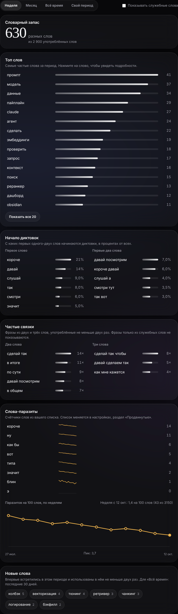
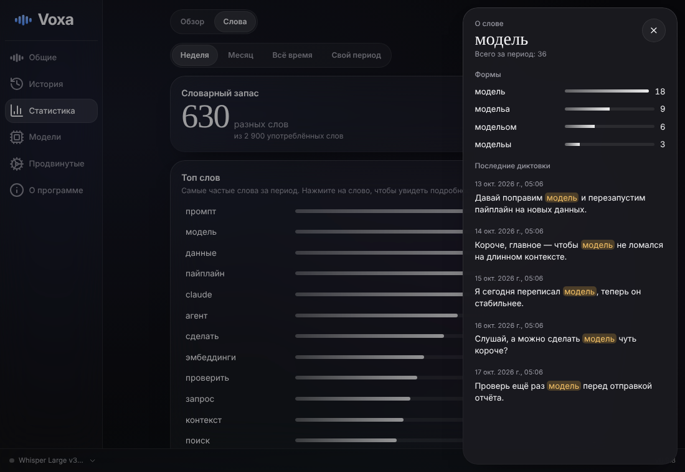
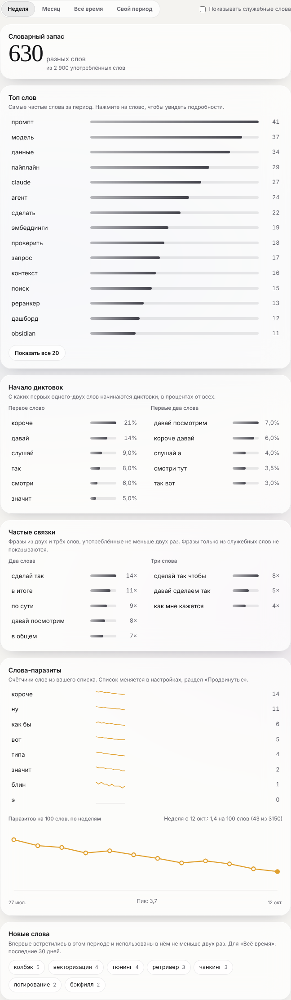
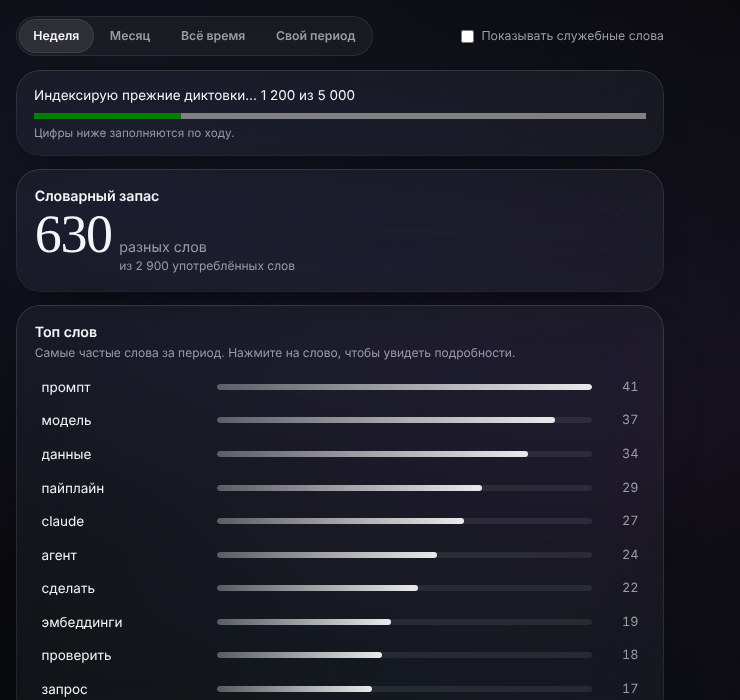
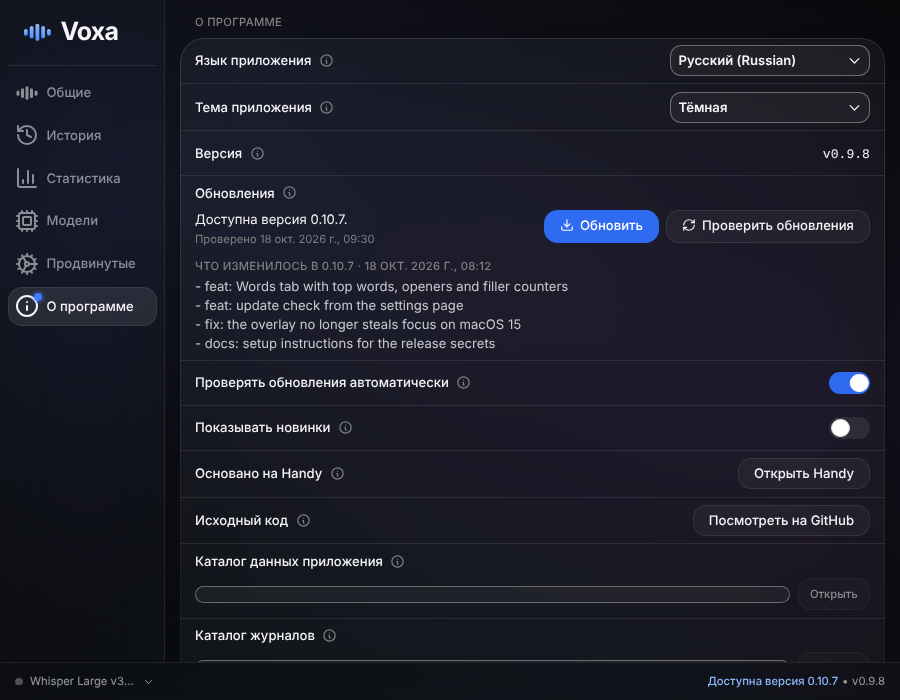
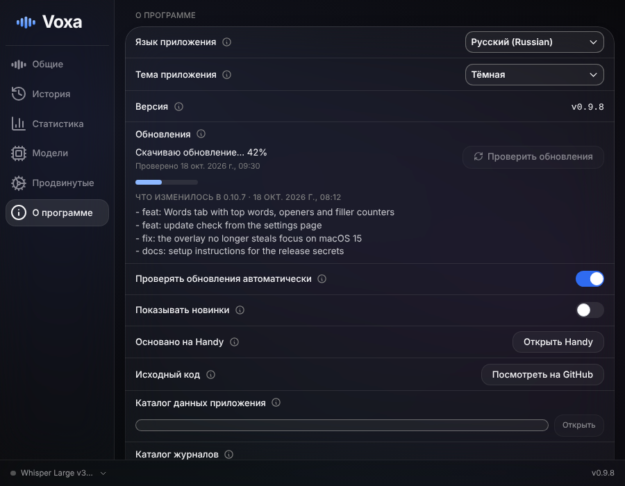

# Voxa, итерация 2: обновления внутри приложения и статистика по словам

**Коротко.** Сделаны обе части: приложение умеет обновляться кнопкой (проверка в фоне, список изменений, установка по нажатию), а на экране статистики появилась вкладка «Слова». Всё проверено автотестами, бенчмарком и скриншотами. **Не проверено на реальном Mac и не запускалось в GitHub:** установка обновления целиком и релизный workflow `voxa-release`. Для них нужны ваши секреты (10 минут, инструкция [SETUP_SECRETS.md](SETUP_SECRETS.md)) и слияние ветки в `main`. PR я не открывал: вы закрыли предыдущий словами «пр не нужен», а PLAN-2 его требует; ссылка для открытия в конце.

## Что сделано

### Часть A. Обновления

| Что                  | Результат                                                                                                                                                                                                                                                                                                                            |
| -------------------- | ------------------------------------------------------------------------------------------------------------------------------------------------------------------------------------------------------------------------------------------------------------------------------------------------------------------------------------ |
| Апдейтер             | `tauri-plugin-updater` снова включён (D-17). Проверка в Rust: через 30 с после запуска и каждые 6 часов, тихо; при ошибке фоновой проверки ничего не меняется. Ключ из Handy заменён заглушкой, свой ключ подставляет релизный workflow.                                                                                             |
| Установка            | Только по кнопке «Обновить»: скачивание, проверка подписи, замена `.app`, перезапуск. Модели, история, статистика, настройки лежат в `~/Library/Application Support/com.daniyar.voxa/` и не трогаются.                                                                                                                               |
| Где видно            | «О программе»: версия, статус, список изменений, «Проверить обновления», «Обновить», переключатель «Проверять обновления автоматически» (по умолчанию включён; миграция один раз включает его тем, у кого первая сборка сохранила «выключено»). Точка на значке «О программе», ссылка в подвале, пункт «Обновить до vX» в меню трея. |
| Ошибки               | Понятные тексты: нет сети, подпись не сошлась, релизов нет, обновления не настроены. Текущая версия продолжает работать.                                                                                                                                                                                                             |
| Релизный workflow    | [voxa-release.yml](../.github/workflows/voxa-release.yml): версия `0.10.<номер запуска>` (D-18), сборка, подпись постоянным сертификатом, архив `Voxa.app.tar.gz` с подписью, `latest.json`, GitHub Release с changelog из коммитов (D-19). Без секретов: зелёный, ad-hoc, предупреждение, релиз не публикуется.                     |
| Постоянная подпись   | Сертификат из секретов во временной связке ключей; задание падает, если требование подписи (`codesign -d -r-`) не называет bundle id и сертификат. Скрипт [make-signing-cert.sh](../scripts/voxa/make-signing-cert.sh) создаёт сертификат одной командой (проверен на OpenSSL 3).                                                    |
| Скрипты релиза       | [release_manifest.py](../scripts/voxa/release_manifest.py) (версия, changelog, `latest.json`), 9 тестов, запускаются в CI.                                                                                                                                                                                                           |
| Секреты и инструкция | Секреты из сессии выставить нельзя (B-04). Написан [SETUP_SECRETS.md](SETUP_SECRETS.md) для не очень знакомого с терминалом.                                                                                                                                                                                                         |

### Часть B. Статистика по словам

Вкладка «Слова» на странице «Статистика» (рядом с «Обзором»). Фильтр периода: неделя (7 дней), месяц (30 дней), всё время, свой период (D-22); он управляет всеми блоками.

| Блок            | Что показывает                                                                                                                                                                                                                 |
| --------------- | ------------------------------------------------------------------------------------------------------------------------------------------------------------------------------------------------------------------------------ |
| Словарный запас | Число разных слов за период и сколько слов всего.                                                                                                                                                                              |
| Топ слов        | 50 слов с полоской частоты (показано 15, «Показать все»); служебные слова скрыты, переключатель «Показывать служебные слова» работает без пересчёта (D-21). Показывается самая частая реальная форма («промпт», а не «промп»). |
| Начало диктовок | Первые 1 и 2 слова диктовки, в процентах от диктовок периода.                                                                                                                                                                  |
| Частые связки   | Топ двух- и трёхсловных фраз, использованных не меньше двух раз; фразы только из служебных слов не показываются.                                                                                                               |
| Слова-паразиты  | Счётчик по каждому слову, мини-линия по неделям и общая линия «на 100 слов» за 12 недель. Список меняется в «Продвинутые», многословные («как бы») считаются как фраза.                                                        |
| Новые слова     | Слова, впервые встреченные в периоде и использованные не меньше двух раз (для «Всё время» берутся последние 30 дней).                                                                                                          |
| Панель слова    | Клик по слову: все формы с частотами и пять последних диктовок с подсвеченным словом; Esc или клик вне панели закрывает.                                                                                                       |

Под капотом: стемминг `rust-stemmers` (русский и английский), стоп-слова RU и EN, суточные агрегаты в `voxa_stats.db` (миграция 2, существующие данные не меняются), бэкфилл прежних диктовок в фоне с индикатором и возможностью продолжить после остановки, вычитание вклада при удалении записи из истории (очистка истории по лимиту статистику не трогает, D-23), еженедельная чистка одноразовых фраз (D-25). Подробности и обоснования отступлений от PLAN-2: [DECISIONS.md](DECISIONS.md), D-20 … D-27.

## Скриншоты

| Вкладка «Слова» (тёмная)        | Панель слова                           |
| ------------------------------- | -------------------------------------- |
|  |  |

| Светлая тема                     | Идёт индексация прежних диктовок         |
| -------------------------------- | ---------------------------------------- |
|  |  |

Баннер обновления в «О программе»:

| Доступна версия                             | Скачивание                                    |
| ------------------------------------------- | --------------------------------------------- |
|  |  |

Ещё: [светлая тема](screenshots/updates-available-light.png), [ошибка сети](screenshots/updates-error-dark.png), [вкладка в окне приложения](screenshots/words-app-dark.png). Данные на скриншотах фиктивные (`src/voxa/preview/wordsFixtures.ts`).

## Что проверено и чем

| Проверка               | Результат                                                                                                                                                                                                                                                                                                                                                                                                                             |
| ---------------------- | ------------------------------------------------------------------------------------------------------------------------------------------------------------------------------------------------------------------------------------------------------------------------------------------------------------------------------------------------------------------------------------------------------------------------------------- |
| `cargo test`           | 388 прошло, 0 упало (19 игнорируются: 18 как в upstream и бенчмарк). Новые: апдейтер (классификация ошибок, фоновые и ручные проверки, миграция настройки), слова (формы и основа, `Claude'а`, числа, стоп-слова при запросе, периоды, начало диктовки с пунктуацией, связки, паразиты и тренд, новые слова, вычитание при удалении, бэкфилл: идемпотентность и продолжение, чистка, равенство ответов до и после накопления итогов). |
| Бенчмарк B.4           | 20 000 синтетических диктовок за два года, release-сборка: **3,0 мс на диктовку** (в фоновом потоке, к задержке диктовки не добавляется), **любой запрос 0,4 … 50 мс** при пределе 150 мс (всё время, 30 дней, 7 дней). `cargo test --release words::tests::bench -- --ignored --nocapture`.                                                                                                                                          |
| TypeScript и интерфейс | `bun run test:unit` (форматирование периодов и графика), ESLint, tsc, Prettier, `check:translations` чистые.                                                                                                                                                                                                                                                                                                                          |
| Playwright             | 49 тестов (из них 14 для «Слов», 6 для обновлений): все блоки, переключатель служебных слов, фильтр периода, развёртывание списка, панель слова и закрытие, пустое состояние, ошибка блока с повтором, индикатор индексации, английский язык.                                                                                                                                                                                         |
| Скрипты релиза         | 9 тестов Python.                                                                                                                                                                                                                                                                                                                                                                                                                      |
| CI                     | См. раздел «Блокеры и статус».                                                                                                                                                                                                                                                                                                                                                                                                        |

**Не проверено (нужен Mac или ваши секреты):** установка обновления целиком (скачивание, подмена `.app`, перезапуск), релизный workflow (ни разу не запускался: создание ключа, импорт сертификата, подпись, публикация релиза), пункт меню трея на macOS, сохранение разрешений macOS между обновлениями при самоподписанном сертификате.

## Что вам сделать руками

1. **Слейте ветку в `main`.** Релизный workflow запускается пушем в `main`, и обновления появляются только из релизов. Откройте: https://github.com/Dudu2I3/voxa/pull/new/claude/magical-ritchie-lg9k96 (PR я не открывал, см. выше), заполните «Human Written Description» своими словами.
2. **Заведите секреты** по [SETUP_SECRETS.md](SETUP_SECRETS.md): ключ обновлений (3 секрета) и сертификат подписи (2 секрета).
3. **Запустите `voxa-release`** вручную (Actions → voxa-release → Run workflow → `main`) и дождитесь релиза `v0.10.N` на странице Releases.
4. **Скачайте приложение из Releases в последний раз:** `Voxa-macos-arm64.zip`, перенесите `Voxa.app` в «Программы», `xattr -cr /Applications/Voxa.app`.
5. **Выдайте разрешения** «Микрофон», «Универсальный доступ», «Мониторинг ввода» один раз. С постоянным сертификатом они сохранятся при обновлениях. Если всё же слетели: `tccutil reset Accessibility com.daniyar.voxa` и выдать заново.
6. Старый Handy можно удалить: `brew uninstall --cask handy`. Слова из его словаря Voxa предложит перенести баннером.

## Как проверить, что апдейтер работает

После слияния любого следующего PR в `main` релизный workflow выпускает версию с большим номером. Через проверку (до 6 часов или кнопка «Проверить обновления» в «О программе») в приложении появится «Доступна версия 0.10.N», точка на «О программе», ссылка в подвале и пункт в меню трея. Нажмите «Обновить»: приложение перезапустится на новой версии, настройки, словарь, история, статистика и модели останутся. Если проверка пишет «Обновления ещё не настроены», в сборке нет публичного ключа (секрет `TAURI_UPDATER_PUBKEY`, шаг 1 в инструкции).

## Блокеры и статус

- **B-04:** сессия не может ставить секреты (API секретов закрыт прокси, 403). Поэтому шаги 2 и 3 выше ваши. Подробности: [BLOCKERS.md](BLOCKERS.md).
- **CI `voxa-macos`:** на последнем коммите ветки запущен, результат смотрите в Actions; предыдущие два красных запуска были промежуточными коммитами (bindings ещё не были пересобраны).
- **PR:** не открыт по вашему прежнему решению; открывается одной ссылкой из шага 1.
- Остальное из итерации 1 (B-01, B-02) без изменений.

## Решения

Новые решения: [DECISIONS.md](DECISIONS.md), D-17 … D-27 (апдейтер, версии, подпись релиза, структура и отступления в хранении слов, периоды, удаление, бэкфилл, чистка, паразиты, примеры слова).
