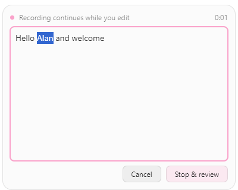

# Live transcript editing on Windows

Mocked browser fixture: recognition, native window focus, and paste delivery are simulated.

With the Live recording overlay enabled, click the transcript to edit while
recording continues. Manual corrections take precedence as recognition updates.
Choose **Stop & review** (or **Ctrl+Enter**) to finish recognition, then choose
**Paste** (or **Ctrl+Enter** again) to send the reviewed draft. Enter inserts a
line break. Moving focus away does not paste. **Cancel** or **Escape** discards
the draft. Ordinary dictation keeps its existing behavior when the editor is closed.

When recognition cannot be merged safely, **Latest recognition** appears beside
the preserved draft. Review the final text before pasting. The original recognition
stays in history; the reviewed draft uses the existing processed-text field.
Optional post-processing still runs before the final review. No snippet expansion
or other replacement rules are introduced.

Paste restores and verifies the destination captured before editing, with the
recording-start destination as a fallback. Failure keeps the draft available for
retry or manual copying. Check the destination before retrying, because a reported
error can occur after some text has reached the destination. Reviewed output uses
the guarded synchronous paste path, including when reliable paste is enabled.

Editing is available on Windows. macOS and Linux retain read-only live transcripts.
The automated browser fixture mocks recognition and native IPC; it cannot verify
microphone capture, native window activation, or delivery into another application.
The editor's Rust merge and state tests cover correction retention and stale updates.

## Validation scope

This independent contribution preserves upstream updater and release configuration.
It does not include the fork's snippets, version changes, marketing, or debug-only
native preview CLI. A full native build and cross-application microphone/paste proof
remain required before claiming native end-to-end verification.
